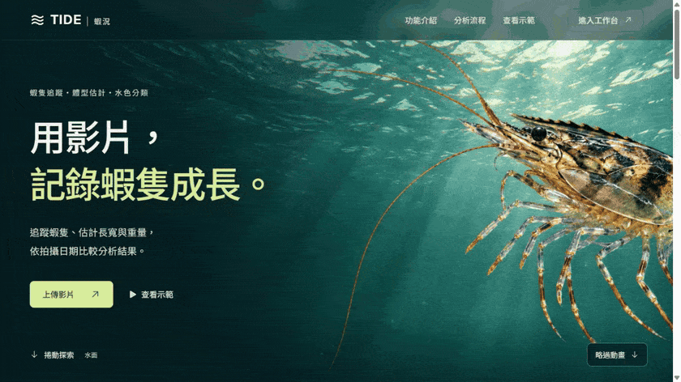

# TIDE Shrimp Monitoring

An integrated shrimp video analysis and monitoring system: detection, tracking and sex classification, water appearance classification, size and weight estimates, and a web workspace for reviewing measurements and asking questions about the data.

[](web/README.md#interface-tour)

The preview plays the complete homepage scroll animation, then rewinds and loops. [View the static image](web/docs/screenshots/landing.jpg).

See the [interface tour](web/README.md#interface-tour) for dashboard, upload and AI-analysis screenshots. Measurement examples use synthetic data; the landing scene is an illustration.

## Repository layout

```text
TIDE-Shrimp-Monitoring/
├── tracking/   # Integrated Python inference and monitoring engine
└── web/        # Next.js frontend, FastAPI API/worker, PostgreSQL and AI assistant
```

These are two parts of the same system. `tracking/` runs independently from Python. The web architecture delegates inference to a separate worker, outside HTTP requests. The worker creates a separate TOML configuration for each job and invokes the tracking entry with `--config`; see [tracking usage](tracking/general_track/README.md#outputs-and-external-callers).

| Component | Included features | Documentation |
| --- | --- | --- |
| Tracking engine | YOLO OBB detection and tracking IDs, head/tail crop orientation and CNN/classifier-based sex classification; integrated first-frame water classification, calibrated length/width estimates and weight regression | [Tracking setup and models](tracking/README.md) |
| Monitoring outputs | Annotated video, per-ID summaries, CSV measurements, water classification and calibration metadata | [Integration guide](tracking/docs/monitoring-integration.md) |
| Web application | Video upload/inbox, background jobs, playback, date/pond filters, length/width/weight distributions and CSV export | [Web setup](web/README.md) |
| AI analysis | Natural-language questions, follow-up context, ten chart templates, descriptive statistics, Pearson/Spearman correlation, Welch t-test and Welch ANOVA | [AI analysis guide](web/docs/ai-analysis.md) |

The application interface and AI answers remain in Traditional Chinese. Maintained setup documentation and new integration comments are in English; archived upstream material retains its original language.

## Origins and development history

This repository is a fork of [NxBLANKxN/Shrimp-Male-Yolo-Tracking](https://github.com/NxBLANKxN/Shrimp-Male-Yolo-Tracking), based on upstream revision [`5662c81`](https://github.com/NxBLANKxN/Shrimp-Male-Yolo-Tracking/commit/5662c81ba1ad86b04cbc0bfe6206df1599dbc36a). Its detection, tracking and sex-classification implementation remains the foundation of `tracking/`.

Water classification and biometric conversion were adapted from [chenne0819/ShrimpVisionRT](https://github.com/chenne0819/ShrimpVisionRT), revision [`dd87698`](https://github.com/chenne0819/ShrimpVisionRT/commit/dd876980b83e42986b54c1ebeb52017c0728f113). The four original regression models are included in [tracking/model/biometrics/](tracking/model/biometrics/), and the water classifier checkpoint is included in [tracking/model/water/](tracking/model/water/). Model provenance, hashes and reference geometry are documented in [the asset manifest](tracking/model/assets-manifest.json) and [biometric provenance](tracking/model/biometrics/provenance.json).

The upstream Git history is retained. The [original upstream README](tracking/docs/README-original.md) is preserved for attribution and historical context.

## Getting started

Requirements: Git (and Git LFS for inherited upstream LFS assets), Python 3.14 for tracking in the repository-root `.venv`, Node.js 22 or later, PostgreSQL, and compatible inference weights. The tracking requirements target an NVIDIA GPU with CUDA 12.6 PyTorch wheels; verify GPU execution with `tracking/check-gpu.py`.

1. Clone this repository. Prepare the tracking environment and the required model files using [tracking/README.md](tracking/README.md). The optional Windows helper is `tracking/setup-monitoring.ps1`.
2. Configure the web environment following [web/README.md](web/README.md): create `web/.venv`, install the backend requirements, run `npm ci` in `web/frontend`, and copy `web/.env.example` to `web/.env`.
3. Choose your own PostgreSQL password and set `DATABASE_URL` and `POSTGRES_PASSWORD` consistently. `web/compose.yaml` can start a database bound to localhost. Do not deploy the example password.
4. Keep `ANALYZER_ROOT=../tracking` in `web/.env`. Paths resolve from `web/`, independently of the shell working directory. Explicitly set `ANALYZER_PYTHON=../.venv/Scripts/python.exe` on Windows (or `../.venv/bin/python` on Linux) to use the repository-root tracking environment. The old `tracking/.venv` is no longer used.
5. Start the API, background worker and frontend in separate terminals. On Windows, run the following from `web/`:

```powershell
# Terminal 1: API
.\scripts\start-local.ps1 -Service api

# Terminal 2: background inference worker
.\scripts\start-local.ps1 -Service worker

# Terminal 3: Next.js
.\scripts\start-local.ps1 -Service web
```

Open [the web workspace](http://127.0.0.1:3000/dashboard), [the upload page](http://127.0.0.1:3000/upload), or [the API documentation](http://127.0.0.1:8000/docs). The [explicit demo](http://127.0.0.1:3000/dashboard?demo=1) uses synthetic measurements and does not include private recordings or extracted thumbnails. Standalone tracking and web video jobs use the same TOML entry. Real analysis requires compatible model assets and a running worker.

AI is disabled by default. The `codex` provider uses an existing local Codex login for trusted local testing; the `openai` provider uses the official OpenAI Responses SDK and a separate server-side API key. See [AI configuration](web/docs/ai-analysis.md). No account session or API key is supplied by this repository.

## Models and measurement limits

- The four `.pkl` regression models and water-classification `.pth` checkpoint are included as ordinary Git files. Enable `biometrics` and `water_quality` independently in TOML. The tracking runtime uses Python 3.14 and `scikit-learn==1.9.1`; the original regressors were saved with 1.6.1, as retained in their provenance.
- The selected mode's trained YOLO detector and sex-classification weights must still be obtained separately using the documented `tracking/model/` layout. Inherited upstream LFS entries do not supply that private bundle. Original measurement spreadsheets and training datasets are not included.
- Water results describe image appearance (`clear` / `turbid`) from the first frame. They are not pH, dissolved oxygen or a complete water-quality measurement.
- Width is an OBB short-edge proxy; length and weight are model estimates. The inherited reference is 800 × 450 at 2.5 pixels/mm. Recalibrate after changing the camera, distance, framing or geometry; resizing alone does not establish a physical scale.
- The `run_track` entry retains head/tail tracking and classifier-based sex classification.
- Tracking settings now use `tracking/general_track/config.toml`; the entry accepts only `--config` and `--help`. The web worker derives job configurations from that template, enables both monitoring models and saves results without opening a preview window.
- Tracking IDs are local to a video. Comparisons across videos or dates do not establish the growth of the same individual shrimp.
- EMA stabilizes preview labels and new web result videos. Web video smoothing uses video time and leaves raw CSV predictions, measurements and final majority voting unchanged. Existing completed videos need a new analysis to show the effect. Standalone exports opt in with `smooth_video = true`. The [EMA tuning summary](tracking/docs/ema-threshold-results.md) records the six-video experiment; its candidate threshold was not applied to the live configuration.

## Privacy and deployment

The ignore rules exclude local `.env` files, authentication caches, keys, databases, uploaded recordings, private demo footage, unpublished model weights, virtual environments and build output. The five published monitoring checkpoints have explicit exceptions in `tracking/.gitignore`. Only configuration templates are included for environment settings. Keep credentials on the server; never place them in `NEXT_PUBLIC_*` variables.

The current application is intended for a trusted local environment. Public multi-user deployment requires application authentication and appropriate deployment controls, including HTTPS, record authorization, upload quotas, storage retention and backups. Preserve upstream authorship and any applicable source/dependency notices when redistributing; this repository does not declare a new blanket license for upstream code or external model assets.

## Tests and contributions

Test commands are documented in the [tracking setup](tracking/README.md#tests-and-upstream-credits) and [web setup](web/README.md#animation-and-checks). The monitoring tests use the bundled regression and water models. Software tests do not establish model accuracy.

For future changes, use focused English commit messages and keep functional changes separate from broad formatting or directory moves. Include the checks that were actually run. Never commit credentials or private recordings when adding a reproducible test case.
